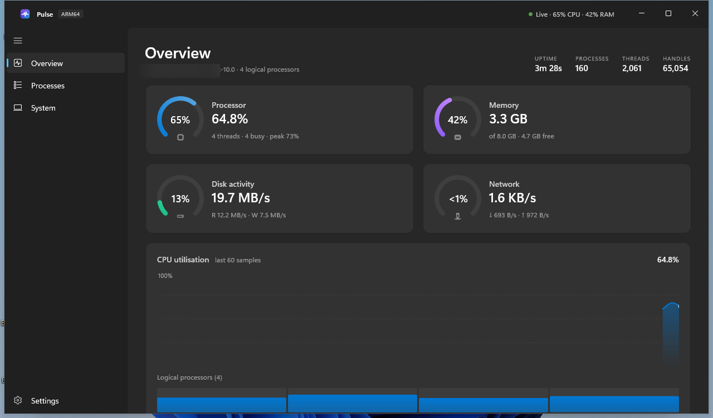
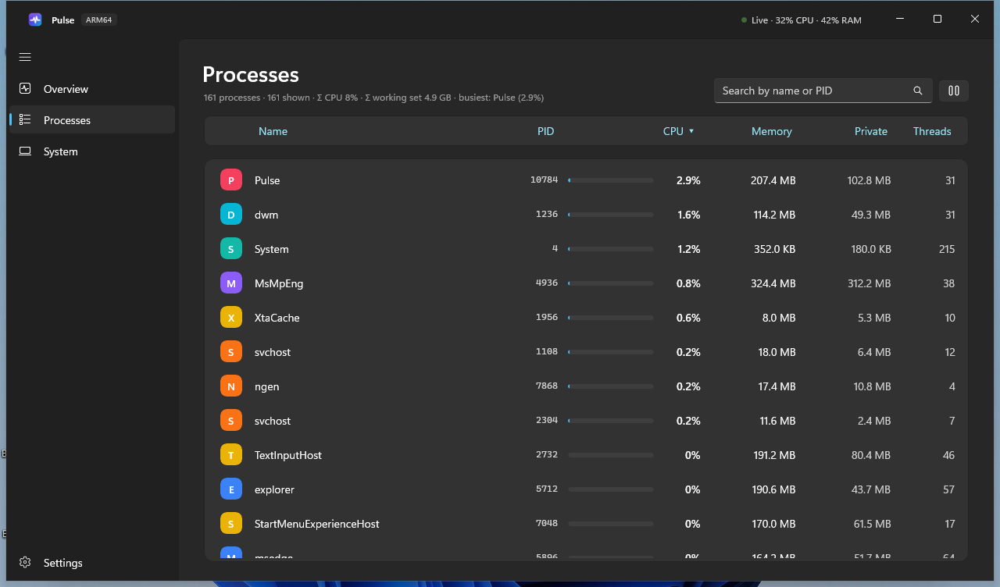
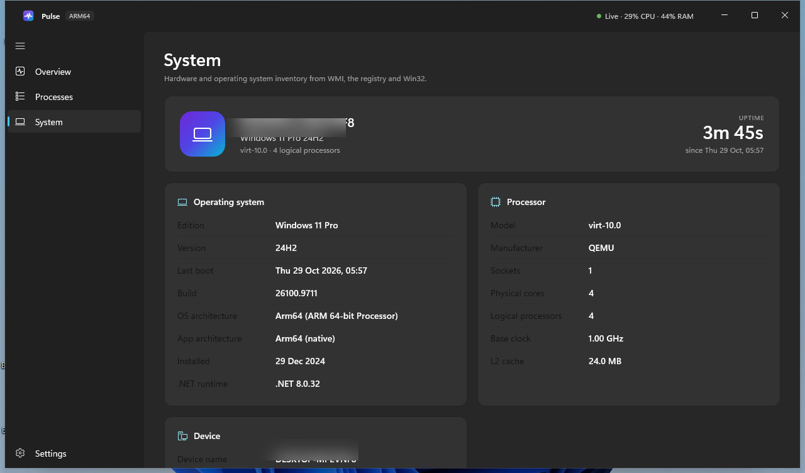
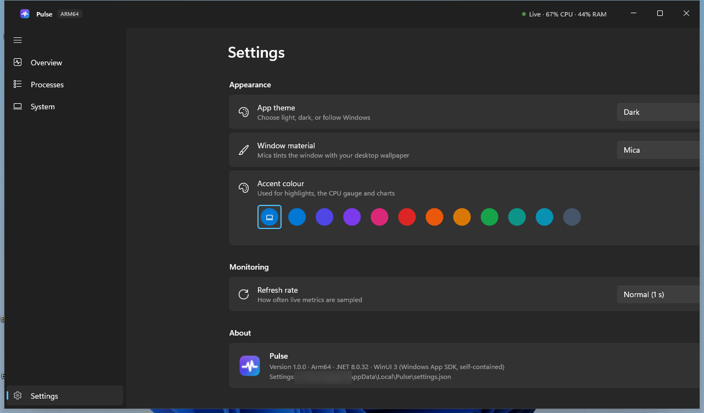
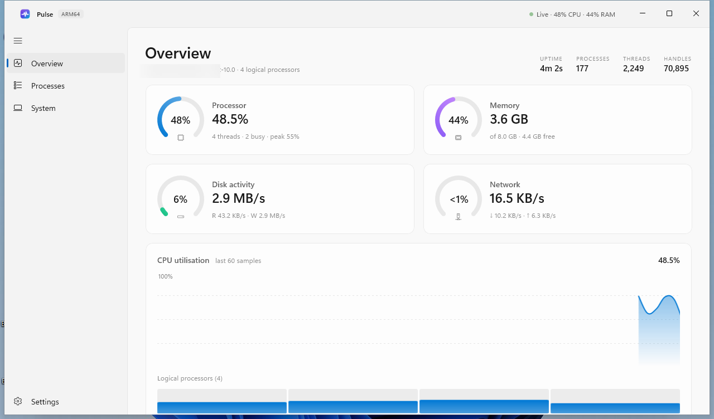
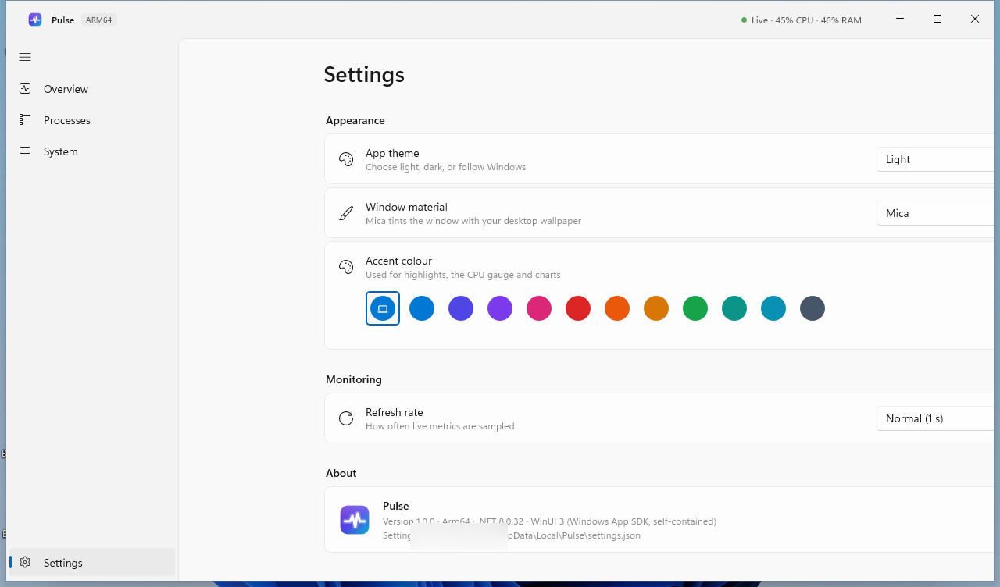

# Pulse

[](LICENSE)
[](https://github.com/charles-forsyth/pulse-windows/releases/latest)
[-0078D4?logo=windows)](https://github.com/charles-forsyth/pulse-windows/releases)
[](https://charles-forsyth.github.io/pulse-windows/)

A fast, modern, and beautiful real-time system monitor for Windows 11 and 10. Built natively with **WinUI 3** (Windows App SDK) and **.NET 8**, Pulse delivers instant hardware and process telemetry wrapped in a sleek Fluent Design interface with Mica materials and dark/light modes.

Pulse is distributed as unpackaged, fully self-contained single-file executables for both **ARM64** and **x64** architectures.

---

## Screenshots

| Overview (Dark Mode) | Processes View |
| :---: | :---: |
|  |  |

| Hardware & OS Inventory | Settings & Theming |
| :---: | :---: |
|  |  |

| Overview (Light Mode) | Settings (Light Mode) |
| :---: | :---: |
|  |  |

---

## Features

- **Real-Time Telemetry Gauges**: Animated radial ring gauges monitoring CPU utilisation, memory consumption, disk read/write throughput, and network I/O.
- **CPU Timeline & Per-Core Utilization**: Smooth-scrolling historical area chart (60-sample window) paired with real-time logical core load bars.
- **Live Process Manager**: Searchable and sortable process explorer detailing PID, CPU delta, working set memory, private commit bytes, and thread counts. Includes a live pause button to freeze metrics during inspection.
- **Complete System Inventory**: OS version and build metadata, processor specs (cores, sockets, clock speed, cache), BIOS/motherboard details, and memory topology sourced from WMI, registry, and Win32 APIs.
- **Windows 11 Fluent Design**: Native Mica, Mica Alt, and Acrylic materials with automatic system accent color matching, theme switching (Light / Dark / System), and customizable polling intervals.
- **Self-Contained & Unpackaged**: Zero external framework dependencies. No .NET runtime installation or MSIX package manager required. Runs portably anywhere.

---

## Download & Installation

Pre-built binaries are available on the [Releases page](https://github.com/charles-forsyth/pulse-windows/releases/latest):

| Architecture | Package | Target Hardware |
| :--- | :--- | :--- |
| **ARM64** | `Pulse-arm64.zip` | Qualcomm Snapdragon X Elite/Plus, Surface Pro ARM, Apple Silicon VMs |
| **x64** | `Pulse-x64.zip` | Intel Core / Xeon, AMD Ryzen / EPYC 64-bit systems |

### Installation Instructions
1. Download the zip archive matching your system architecture.
2. Extract the archive to any folder (e.g. `C:\Tools\Pulse`).
3. Double-click `Pulse.exe` to launch.

> **Windows SmartScreen Notice**: Pulse is open-source software built from source and is not signed with an expensive commercial code-signing certificate. When running Pulse for the first time, Windows SmartScreen may show a blue prompt stating *"Windows protected your PC"*. To run Pulse, click **More info** and then select **Run anyway**.

---

## Command Line & Deep Linking

Pulse supports direct command-line arguments to launch into specific views:

```cmd
Pulse.exe --page overview
Pulse.exe --page processes
Pulse.exe --page system
Pulse.exe --page settings
```

To enable verbose startup diagnostics and first-chance exception logging:
```cmd
set PULSE_TRACE=1
Pulse.exe
```
Logs will be written to `%LOCALAPPDATA%\Pulse\pulse.log`.

---

## Data Sources & Architecture

Pulse collects low-overhead metrics directly through kernel Win32 APIs:
- **Processor & CPU Times**: `GetSystemTimes` and `NtQuerySystemInformation`
- **Memory Statistics**: `GlobalMemoryStatusEx` and `GetPerformanceInfo`
- **Storage & Disk Activity**: Windows `PhysicalDisk` performance counters
- **Network Interfaces**: `System.Net.NetworkInformation.NetworkInterface` throughput delta counters
- **Process List**: Delta calculations over `Process.TotalProcessorTime` sampled on background worker threads
- **Hardware Inventory**: Windows Management Instrumentation (`System.Management` WMI) and Registry queries

---

## Building from Source

### Prerequisites
- Windows 10 (version 19041+) or Windows 11
- [.NET 8.0 SDK](https://dotnet.microsoft.com/download/dotnet/8.0)
- Visual Studio 2022 (with *.NET Desktop Development* and *Windows App SDK C# Templates*)

### Build Commands
Clone the repository and publish a self-contained release executable:

```powershell
git clone https://github.com/charles-forsyth/pulse-windows.git
cd pulse-windows

# Build ARM64 release
dotnet publish Pulse.csproj -c Release -r win-arm64 --self-contained true

# Build x64 release
dotnet publish Pulse.csproj -c Release -r win-x64 --self-contained true
```

Or execute the included automated packaging script:
```powershell
pwsh tools/publish.ps1
```

---

## Citation

If you use Pulse in research or system benchmarking, please cite it using the following metadata:

```bibtex
@software{forsyth2026pulse,
  author       = {Forsyth, Charles E. III},
  title        = {Pulse: Modern System Monitor for Windows},
  year         = {2026},
  publisher    = {GitHub},
  version      = {1.0.0},
  url          = {https://github.com/charles-forsyth/pulse-windows},
  note         = {DOI: pending}
}
```

See [`CITATION.cff`](CITATION.cff) for complete CFF 1.2.0 metadata.

---

## License

This project is licensed under the [MIT License](LICENSE). Copyright (c) 2026 Charles Forsyth.
